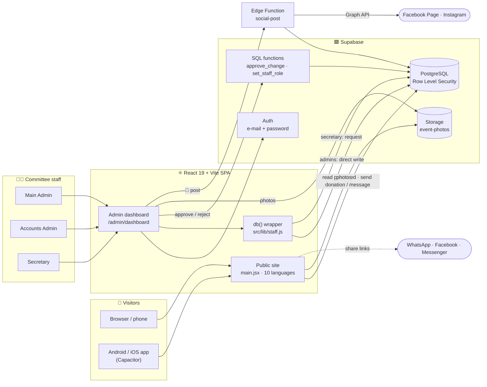
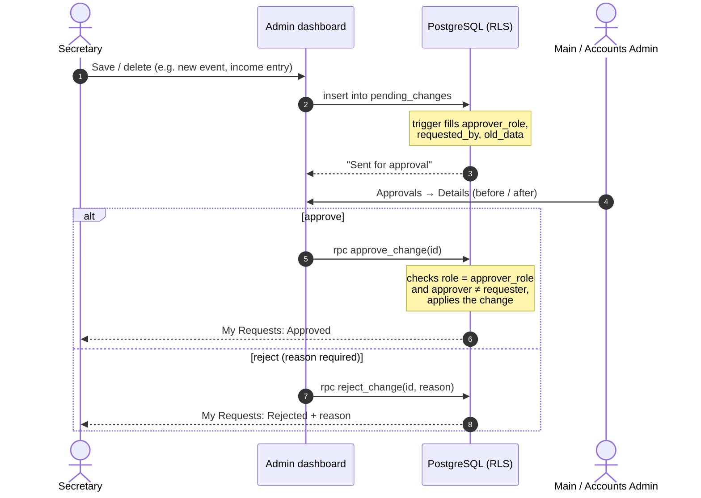
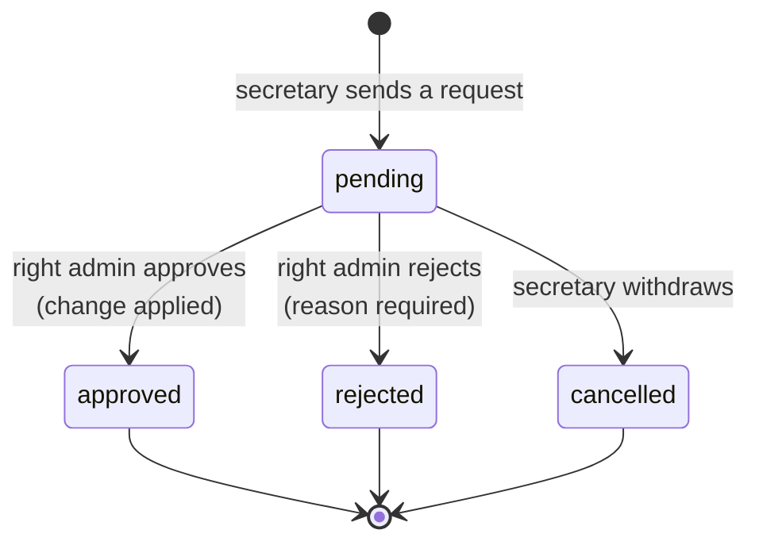
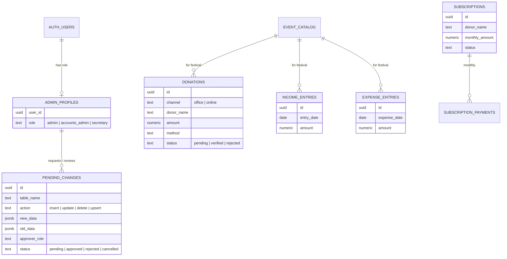
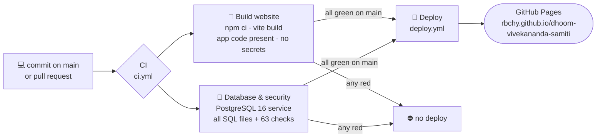
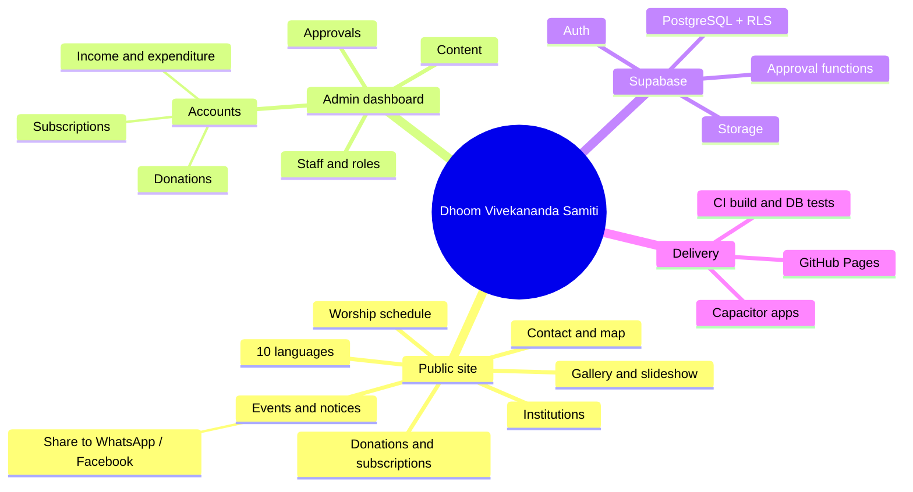

<div align="center">

<a href="https://rbchy.github.io/dhoom-vivekananda-samiti/" title="Open the website"></a>

<!-- ============ STATUS BAR ============ -->
[](https://github.com/rbchy/dhoom-vivekananda-samiti/actions/workflows/ci.yml)
[](https://github.com/rbchy/dhoom-vivekananda-samiti/actions/workflows/deploy.yml)


[](https://rbchy.github.io/dhoom-vivekananda-samiti/)
[](docs/ADMIN-HELP.md)
[](https://github.com/rbchy)

</div>

---

## 📌 At a Glance

<table>
<tr>
<td width="50%" valign="top">

**🙏 What this is**

The public website and the back-office system of **Dhoom Vivekananda Samiti**, a religious and
humanitarian organisation in Dhoom, Mirsharai (Chattogram, Bangladesh), inspired by Sri Ramakrishna,
Holy Mother Sri Sarada Devi and Swami Vivekananda.

Visitors read about the temples, see worship times and festivals, browse the gallery, donate and
send messages — in **10 languages**. Committee staff run everything from an **admin dashboard**
where changes by the secretary wait for **approval** by the right admin.

> *"As many faiths, so many paths."* — Sri Ramakrishna

</td>
<td width="50%" valign="top">

**📍 Quick facts**

| | |
|---|---|
| 🏛️ **Institutions** | 6 (5 temples + community clinic) |
| 🌐 **Languages** | 10 (incl. Bangla, Arabic RTL) |
| 👥 **Staff roles** | Main Admin · Accounts Admin · Secretary |
| 🗄️ **Database** | Supabase PostgreSQL, RLS on every table |
| ✅ **CI** | build + 14 unit tests + 63 database security checks |
| 🚀 **CD** | GitHub Pages after green CI |
| 📱 **Apps** | Android / iOS via Capacitor |
| 📖 **Help** | [docs/ADMIN-HELP.md](docs/ADMIN-HELP.md) (Bangla) |

</td>
</tr>
</table>

---

## 🏛️ The Samiti and its Institutions

| Institution | What happens there |
|---|---|
| 🛕 **Sree Sree Ramakrishna Mandir** | Daily arati, Kathamrita reading, weekly worship for Thakur, Ma and Swamiji |
| 🌺 **Sree Sree Dokkhin Kalika Mandir** | Worship of Mother Dakshina Kali every Saturday and on Shyama Puja night |
| 🪔 **Sree Sree Durga Mandir** | Spring Basanti Durga Puja and worship of the Divine Mother |
| 🔱 **Sree Sree Shiv Mandir** | Monday Shiva Puja, Shravan worship and Maha Shivaratri |
| 🕯️ **Sree Sree GouriShankar Funeral Temple** | Dignified last rites and a peaceful place of farewell |
| 🩺 **Dhoom Vivekananda Samiti Community Clinic** | Medical advice, first aid and medicines for people in need |

Also: annual clothes distribution and a Gita learning centre for children.

---

## ✨ Features

<table>
<tr>
<td width="50%" valign="top">

**🌐 Public website**

- Institutions, mission & deities, worship schedule
- Events with opening / puja / closing times
- Gallery filtered by institution and category, slideshow, lightbox
- Announcements and scrolling banner message
- **Online donation** (bKash · Nagad · Rocket · bank · card link) and **monthly subscription** sign-up
- Contact form, map, Panjika link, follow links
- **Share any event or notice** to WhatsApp, Facebook, Messenger, or copy ready-made text; shared links open the exact post
- QR code to open the site on a phone
- 10 languages, right-to-left Arabic, installable web app

</td>
<td width="50%" valign="top">

**🛠️ Admin dashboard**

- Temple content, events, gallery (photo auto-enhance), announcements, yearly event list
- Worship schedule, temple info & committee, mission & deities
- **Donations** — office entry, verify online donations, receipts
- **Monthly subscriptions** and payments
- **Income & expenditure** ledger, account heads, statements, CSV export
- Website messages
- **Approvals** — see before/after, approve or reject with a reason
- **My Requests** for the secretary, **Staff & Roles** for the main admin
- "Copy for social" text (Bangla + English) for Facebook groups, WhatsApp channels, TikTok
- **📣 Post to the Facebook Page and Instagram** in one click (main admin) — [setup](docs/SOCIAL-AUTOPOST.md)

</td>
</tr>
</table>

---

## 🏗️ Architecture



**Key ideas**

- **The database is the security boundary.** Every rule lives in PostgreSQL Row Level Security, not in the browser. The website only holds the *publishable* key.
- **One write path for all admin pages.** Pages call `db('table')` instead of `supabase.from('table')`. For admins it *is* `supabase.from`; for the secretary it turns every insert / update / delete / upsert into a row in `pending_changes`.
- **Approvals run inside the database** (`security definer` functions), so they cannot be faked from the browser and nobody can approve their own request.

---

## 👥 Roles and the Approval Workflow

| Role | Can do directly | Approves | Sees |
|---|---|---|---|
| 🛡️ **Main Admin** (`admin`) | Website content, messages, staff roles | Secretary's **content** requests | Everything; accounts **read-only** |
| 💰 **Accounts Admin** (`accounts_admin`) | Donations, subscriptions, income, expenses, account heads — no approval needed | Secretary's **accounts** requests | Accounts sections, Approvals |
| ✍️ **Secretary** (`secretary`) | Nothing directly — sends requests | — | Content + accounts sections, My Requests |





| Request goes to | Tables |
|---|---|
| 🛡️ Main Admin | `events` `gallery` `announcements` `worship_schedule` `temple_highlights` `temple_content` `committee_contacts` `site_settings` `event_catalog` |
| 💰 Accounts Admin | `donations` `subscriptions` `subscription_payments` `income_entries` `expense_entries` `account_heads` |

---

## 🗄️ Data Model



Content tables (public read when published, staff write): `events`, `gallery`, `announcements`, `temple_content`,
`worship_schedule`, `temple_highlights`, `committee_contacts`, `site_settings`. Visitor-only inserts: `contact_messages`,
online `donations`, `subscriptions`.

---

## 🔐 Security Model

| Layer | Protection |
|---|---|
| Browser | Only the Supabase **publishable** key; `.env` is git-ignored |
| Auth | Public sign-up disabled; staff logins created by an admin |
| Database | **RLS on every table**; visitors can only read published items and send donations / messages |
| Online donations | Must be `pending`, dated today, non-cash, no receipt number |
| Roles | `admin_profiles` is read-own-row only; roles change only through `set_staff_role()` (main admin) |
| Approvals | `approve_change()` checks the approver's role and blocks self-approval; only real table columns are applied |
| Storage | `event-photos`: JPEG / PNG / WebP, max 5 MB; admins (and secretary for uploads) only |
| CI | Fails if a real secret key (`sb_secret_…` / service-role JWT) appears in the build |

---

## 🚦 CI/CD



| Workflow | When | What it does |
|---|---|---|
| [`ci.yml`](.github/workflows/ci.yml) | every push to `main`, every pull request, manual | **Build:** installs packages, runs 14 unit tests of the social-post function against a fake Graph API, builds the site, checks the app code is in the bundle and no secret key leaked. **Database:** runs every file in `supabase/` on a fresh PostgreSQL 16 (twice where re-runs must be safe), seeds and removes test data, then [`99-security-tests.sql`](supabase/tests/99-security-tests.sql) |
| [`deploy.yml`](.github/workflows/deploy.yml) | after CI succeeds on `main`, manual | Builds with repository **variables** (`VITE_SUPABASE_URL`, `VITE_SUPABASE_PUBLISHABLE_KEY`, donation details) and publishes to GitHub Pages; skipped until the variables are set |

**What the 63 database checks prove** (excerpt)

| Area | Examples |
|---|---|
| Visitors | cannot add events, cannot make an admin, cannot read donations or requests; can send a pending online donation, cannot claim cash or "verified" |
| No role | a logged-in user without a role cannot make themselves admin, read income or change roles |
| Main Admin | adds events; **cannot** write income |
| Accounts Admin | adds income directly; **cannot** add events, change roles or approve content |
| Secretary | **cannot** write any table directly or approve; requests go to the right admin and are applied only after approval (id cannot be changed) |
| Workflow | reject needs a reason; rejected delete does not delete; settings upsert applied; main admin cannot remove their own role |
| Social post log | only the main admin can read it; nobody can write or delete it from the website (only the Edge Function) |

Run the same checks locally:

```bash
PGHOST=localhost PGUSER=postgres PGDATABASE=postgres bash supabase/tests/run-db-tests.sh
```

---

## 🧰 Tech Stack


| Layer | Technology |
|---|---|
| Front end | React 19, React Router 7, Vite 8, plain CSS, Lucide icons |
| Back end | Supabase: PostgreSQL, Row Level Security, `security definer` functions, Auth, Storage, Edge Functions (Deno) |
| Social | Meta Graph API v25 (Facebook Page photos / feed, Instagram content publishing) |
| Internationalisation | Own lightweight i18n (`src/i18n*.js`): EN · BN · HI · KO · JA · ZH · ES · FR · AR (RTL) · RU |
| Mobile | Capacitor (Android / iOS), web app manifest |
| Quality | GitHub Actions CI, PostgreSQL 16 service container, SQL assertion tests, `node:test` unit tests |
| Delivery | GitHub Pages (CD), sub-path aware build (`VITE_BASE_PATH`) |

---

## 🗺️ Project Map



---

## 📂 Repository Structure

```text
dhoom-vivekananda-samiti/
├── src/
│   ├── main.jsx                 public website (one page, sections)
│   ├── pages/                   admin dashboard pages (Events, Gallery, Finance, Approvals, …)
│   ├── components/              forms, language switcher, slideshow, share buttons, QR code
│   ├── lib/
│   │   ├── supabaseClient.js    Supabase connection (publishable key)
│   │   ├── staff.js             roles + db() wrapper (secretary → pending_changes)
│   │   ├── share.js             share text and links
│   │   └── money.js, finance.js, csv.js, storage.js, imageEnhance.js, validation.js
│   └── i18n*.js                 10-language text
├── public/                      icons, banner, images (e.g. images/belur-math.webp)
├── supabase/
│   ├── *-schema.sql             tables and rules (run in order, see help guide)
│   ├── security-hardening.sql   admin lock-down, donation rules, photo limits
│   ├── roles-and-approvals.sql  roles, pending_changes, approve / reject functions
│   ├── security-audit.sql       read-only report
│   ├── test-data-seed.sql / remove-test-data.sql
│   ├── social-posts-schema.sql  log of Facebook / Instagram posts
│   ├── functions/social-post/   Edge Function + unit tests (Meta Graph API)
│   └── tests/                   CI-only Supabase mock, 63 checks, runner
├── docs/
│   ├── ADMIN-HELP.md            full help guide (Bangla)
│   ├── SOCIAL-AUTOPOST.md       Facebook / Instagram auto-post setup (Bangla)
│   └── banner.svg
├── .github/workflows/           ci.yml, deploy.yml
├── capacitor.config.json        mobile app settings
└── .env.example                 settings template (copy to .env)
```

---

## 🚀 Getting Started

```bash
git clone https://github.com/rbchy/dhoom-vivekananda-samiti.git
cd dhoom-vivekananda-samiti
npm install
cp .env.example .env          # fill in VITE_SUPABASE_URL and VITE_SUPABASE_PUBLISHABLE_KEY
npm run dev                   # http://localhost:5173  ·  admin: /admin/login
```

| Command | Purpose |
|---|---|
| `npm run dev` | Local development server (also on your Wi-Fi, with a QR code) |
| `npm run build` / `npm run preview` | Production build in `dist/` and a local preview |
| `npm run app:android` / `app:ios` | Build and open the mobile app project |
| `bash supabase/tests/run-db-tests.sh` | Database and security checks |

**Database setup (Supabase → SQL Editor, in this order):**
`donations-and-events-schema.sql` → `temple-management-schema.sql` → `site-extras-schema.sql` →
`organisations-gallery-schema.sql` → `storage-photos-policy.sql` → `security-hardening.sql` → `roles-and-approvals.sql`.
Then turn off public sign-up, add staff logins and give roles in **Staff & Roles**.

> Step-by-step instructions, troubleshooting and backups: **[docs/ADMIN-HELP.md](docs/ADMIN-HELP.md)** (Bangla).

---

## 🧹 Maintenance Log

| Date | Change |
|---|---|
| 15 Nov 2026 | Repository created; project folder cleaned (old backups moved to a local `_archive`) |
| 15 Nov 2026 | Security hardening: `admin_profiles` locked, stricter online donations, photo bucket limits; audit script |
| 15 Nov 2026 | Three staff roles with database-enforced approvals; Approvals, My Requests, Staff & Roles pages |
| 15 Nov 2026 | `is_admin()` pinned to the main admin so new roles cannot write content tables directly |
| 15 Nov 2026 | Share buttons for events and notices; "Copy for social" in admin; labels in 10 languages |
| 15 Nov 2026 | CI (build + 42 DB checks) and GitHub Pages deploy; sub-path aware build; manifest icons fixed |
| 15 Nov 2026 | Bangla help guide; Belur Math photo on the home page |
| 16 Nov 2026 | Home banner with Sri Ramakrishna and Belur Math; Facebook Page / Instagram auto-posting (Edge Function, log table, 14 unit + 7 DB tests) |

## 📈 Roadmap

- [x] Code on GitHub with CI
- [x] Database security review and hardening
- [x] Roles and approval workflow
- [x] Social sharing (level 1)
- [ ] Real address, hours, donation numbers and committee details from the Samiti
- [ ] Custom domain and `VITE_SITE_URL`; Google Search Console and Google Business Profile
- [ ] `og:image` tags, `sitemap.xml`, `robots.txt`, 404 page
- [ ] Separate page per institution; community clinic page with doctor schedule
- [ ] PDF donation receipts and a public yearly accounts summary
- [ ] Playwright end-to-end tests for donation, contact, login and approvals
- [x] Automatic posting to the Facebook Page and Instagram (level 3) — needs the Meta setup in [docs/SOCIAL-AUTOPOST.md](docs/SOCIAL-AUTOPOST.md)

## 🔗 Related

| Project | Why it matters |
|---|---|
| [rbchy](https://github.com/rbchy/rbchy) | Author's profile and portfolio website |

---

<div align="center">

**Built with devotion and care by [RB Chowdhury](https://github.com/rbchy)** · *Seva is worship* 🙏

[](https://github.com/rbchy)
[](https://www.linkedin.com/in/rbchy/)
[](mailto:chyranajit@gmail.com)

</div>
