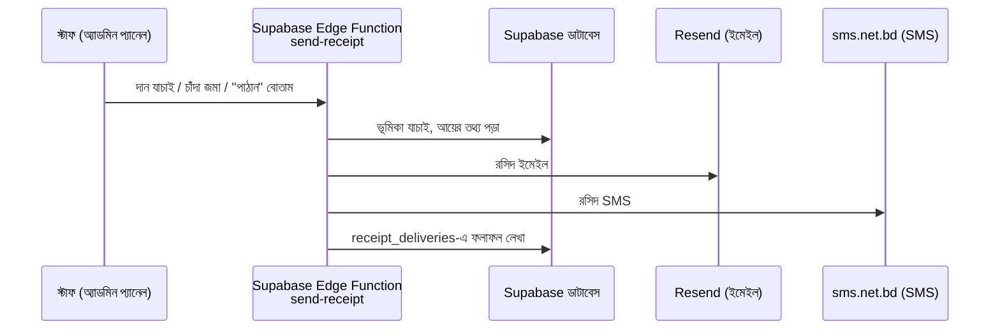

# দাতাকে মানি রসিদ স্বয়ংক্রিয়ভাবে পাঠানো (ইমেইল ও SMS)

দান যাচাই (Verify) করলে, অফিসে দান সংরক্ষণ করলে বা মাসিক চাঁদা জমা নিলে দাতার কাছে রসিদ নিজে থেকেই চলে যায় —
ইমেইল ঠিকানা থাকলে ইমেইলে, বাংলাদেশি মোবাইল নম্বর থাকলে SMS-এ। রসিদের পাতা থেকে হাতেও পাঠানো যায়, আবারও পাঠানো যায়।



গোপন চাবিগুলো (API key) শুধু Supabase-এর সার্ভারে থাকে — ওয়েবসাইটের কোডে বা ব্রাউজারে কখনো যায় না।

## ১. Supabase CLI (একবারই)
Mac-এ Terminal খুলে:
```
brew install supabase/tap/supabase
supabase login
cd ~/eclipse-workspace-Rbc/Dhoom-Vivekananda-Samitee
supabase link --project-ref <আপনার-প্রজেক্টের-ref>
```
(প্রজেক্টের ref = Supabase ড্যাশবোর্ডের ঠিকানায় `/project/` এর পরের অংশ।)

## ২. ডাটাবেস
Supabase → **SQL Editor**-এ `supabase/receipt-deliveries-schema.sql` চালান। এটি পাঠানোর হিসাব রাখার `receipt_deliveries` টেবিল বানায়।
স্টাফরা (প্রধান অ্যাডমিন, হিসাব অ্যাডমিন, সম্পাদক) পড়তে পারেন; কেউ হাতে লিখতে বা মুছতে পারেন না।

## ৩. ইমেইল — Resend
1. **resend.com**-এ অ্যাকাউন্ট খুলুন (ছোট পরিমাণের জন্য বিনামূল্যের প্ল্যান আছে; সীমা ওদের ওয়েবসাইটে দেখে নিন)।
2. **Domains → Add Domain** — সমিতির নিজস্ব ডোমেইন লাগবে (যেমন `dhoomsamiti.org`)। Resend যে DNS রেকর্ডগুলো দেখায়,
   ডোমেইন যেখান থেকে কেনা সেখানে বসান, তারপর **Verify** চাপুন।
   > নিজস্ব ডোমেইন ছাড়া Resend শুধু আপনার নিজের ঠিকানায় পরীক্ষামূলক মেইল পাঠাতে দেয়, দাতাদের কাছে নয়।
   > `github.io` ঠিকানা দিয়ে হবে না — একটা ছোট ডোমেইন কিনে নিতে হবে।
3. **API Keys → Create API Key** (Sending access) → চাবিটা কপি করুন — এটাই **RESEND_API_KEY**।

## ৪. SMS — sms.net.bd (Alpha Net)
1. **sms.net.bd**-এ অ্যাকাউন্ট খুলে ব্যালান্স রিচার্জ করুন (প্রতি SMS-এর খরচ ওদের মূল্যতালিকায়)।
2. প্যানেলের **API** পাতা থেকে API key কপি করুন — এটাই **SMS_NET_BD_API_KEY**।
3. (ঐচ্ছিক) “DVSAMITI”-র মতো নিজস্ব প্রেরকের নাম (masking / sender ID) চাইলে ওদের কাছে আবেদন করুন; অনুমোদন হলে **SMS_SENDER_ID**-এ বসান।
   না বসালে ওদের সাধারণ নম্বর থেকে SMS যাবে।

বাংলা SMS-এ প্রতি অংশে কম অক্ষর ধরে, তাই রসিদের SMS ছোট রাখা হয়েছে (টাকার অঙ্ক, রসিদ নং, তারিখ, কৃতজ্ঞতা)। পুরো রসিদ যায় ইমেইলে।

## ৫. চাবি বসানো ও ফাংশন চালু করা
```
supabase secrets set RESEND_API_KEY=re_xxxxxxxx \
  RECEIPT_EMAIL_FROM="ধুম বিবেকানন্দ সমিতি <receipt@dhoomsamiti.org>" \
  RECEIPT_EMAIL_REPLY_TO=chyranajit@gmail.com \
  SMS_NET_BD_API_KEY=xxxxxxxx

supabase functions deploy send-receipt
```
- `RECEIPT_EMAIL_FROM`-এর ঠিকানা অবশ্যই ধাপ ৩-এ যাচাই করা ডোমেইনের হতে হবে।
- `RECEIPT_EMAIL_REPLY_TO` ঐচ্ছিক — দাতা “Reply” চাপলে উত্তর এই ঠিকানায় আসবে। যে ঠিকানায় উত্তর পেতে চান সেটা দিন।
- শুধু ইমেইল বা শুধু SMS চালু করতে চাইলে অন্যটার চাবি বাদ দিন — সেটা তখন চুপচাপ বাদ পড়বে।

## ৬. পরীক্ষা
1. অ্যাডমিন প্যানেল → **Donations** → নিজের ইমেইল ও মোবাইল দিয়ে অফিসের একটা ছোট দান সংরক্ষণ করুন।
2. বার্তায় দেখাবে `Receipt DVS-… — e-mail ✓, SMS ✓`। ইমেইল ও SMS এসেছে কিনা দেখুন।
3. দানের পাশে **রসিদ** চাপুন → নিচে **পাঠানোর ইতিহাস**-এ দুটো সারি দেখাবে। তারপর পরীক্ষার দানটি মুছে দিন।

## কখন নিজে থেকে যায়, কখন যায় না
| ঘটনা | স্বয়ংক্রিয় রসিদ |
|---|---|
| অনলাইন দান **Verify** করা | ✓ (দাতার ইমেইল/মোবাইলে) |
| অফিসে দান সংরক্ষণ | ✓ |
| মাসিক চাঁদা জমা নেওয়া | ✓ (গ্রাহকের ইমেইল/মোবাইলে) |
| অন্যান্য আয় | ✗ — যোগাযোগের তথ্য থাকে না; রসিদের পাতা থেকে ঠিকানা লিখে পাঠান |
| সম্পাদকের করা এন্ট্রি (অনুমোদনের অপেক্ষায়) | ✗ — অনুমোদনের পর রসিদের পাতা থেকে পাঠান |
| একই রসিদ আগে পাঠানো হয়েছে | ✗ — “আগে পাঠানো হলেও আবার পাঠান” টিক দিয়ে পাঠানো যায় |
| ইমেইল/মোবাইল নেই, বা বিদেশি নম্বর | ✗ — SMS শুধু বাংলাদেশি মোবাইলে যায় |

## সমস্যা হলে
| বার্তা | কারণ | সমাধান |
|---|---|---|
| *Could not reach the receipt-sending service* | ফাংশন চালু হয়নি | ধাপ ৫-এর `supabase functions deploy send-receipt` |
| *E-mail sending is not set up* / *SMS sending is not set up* | চাবি বসানো হয়নি | ধাপ ৫-এর `supabase secrets set` |
| *E-mail service: … domain is not verified* | ডোমেইন যাচাই হয়নি বা From ঠিকানা অন্য ডোমেইনের | ধাপ ৩ |
| *SMS service: Insufficient balance* | SMS ব্যালান্স শেষ | sms.net.bd-তে রিচার্জ |
| *Only staff can send receipts* | লগইন করা ব্যক্তি স্টাফ নন | প্রধান অ্যাডমিন দিয়ে ভূমিকা দিন |

## কোড কোথায়
- `supabase/functions/send-receipt/index.js` — Edge Function (লগইন যাচাই, ডাটাবেস, চাবি)
- `supabase/functions/send-receipt/lib.js` — মূল কাজ: কে পাঠাতে পারে, কোথায় যাবে, একবারের বেশি না যাওয়া, Resend ও sms.net.bd
- `supabase/functions/send-receipt/receipt-text.js` — রসিদের লেখা (কথায় টাকা, ইমেইল, SMS); ওয়েবসাইটের ছাপানো রসিদও এটাই ব্যবহার করে
- `supabase/functions/send-receipt/lib.test.mjs` — আসল সেবা না ছুঁয়ে নকল ইমেইল/SMS দিয়ে ১৩টি টেস্ট। CI-তে প্রতিবার চলে:
  ```
  node --test supabase/functions/send-receipt/lib.test.mjs
  ```
