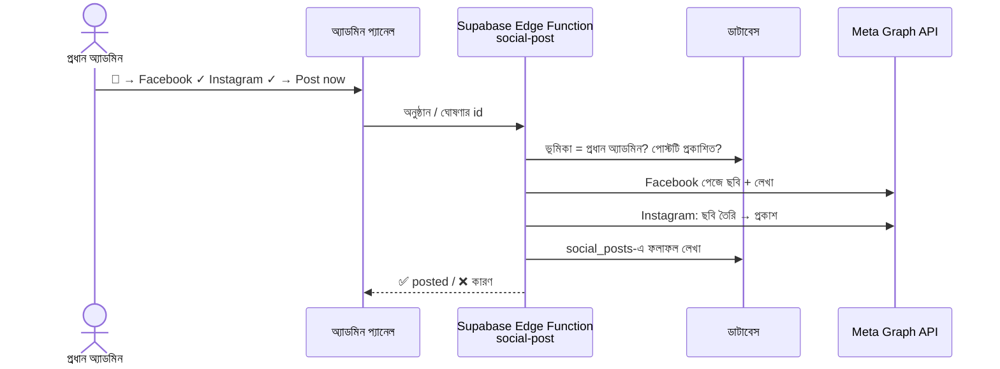

# স্তর ৩ — Facebook পেজ ও Instagram-এ স্বয়ংক্রিয় পোস্ট

অ্যাডমিন প্যানেলের **Events** বা **Announcements**-এ প্রতিটি পোস্টের পাশে **📣 Facebook / Instagram** বোতাম আছে (শুধু প্রধান অ্যাডমিন দেখেন)। চাপলে বেছে নেওয়া যায় কোথায় যাবে, কোন ভাষায় — তারপর **Post now** চাপলেই সমিতির Facebook পেজ আর Instagram-এ পোস্ট হয়ে যায়।



> 🔐 Meta-র চাবি (Page token) থাকে **শুধু Supabase-এর গোপন সেটিংয়ে** — ওয়েবসাইটের কোডে, `.env`-এ বা GitHub-এ কখনো নয়।

---

## ১. আগে যা লাগবে
- সমিতির **Facebook পেজ** আর তার সঙ্গে যুক্ত **Instagram Business অ্যাকাউন্ট** (স্তর ২-এর সেটআপ)।
- আপনি পেজের **অ্যাডমিন**।
- কম্পিউটারে **Supabase CLI** — Mac-এ:
  ```bash
  brew install supabase/tap/supabase
  ```

## ২. ডাটাবেস
Supabase → **SQL Editor**-এ `supabase/social-posts-schema.sql` চালান। এটি পোস্টের হিসাব রাখার `social_posts` টেবিল বানায় (শুধু প্রধান অ্যাডমিন পড়তে পারেন, কেউ হাতে লিখতে বা মুছতে পারেন না)।

## ৩. Meta অ্যাপ বানানো (একবারই)
1. **developers.facebook.com** → নিজের Facebook অ্যাকাউন্টে লগইন → **My Apps → Create App**।
2. ব্যবহারের ধরন হিসেবে **পেজ পরিচালনা / ব্যবসা (Business)** সংক্রান্ত অপশন বেছে নিন; নাম দিন, যেমন `DVS Social Poster`।
3. অ্যাপ **Development** অবস্থায় রাখলেই চলবে। আপনি নিজে অ্যাপের অ্যাডমিন আর পোস্ট যাবে নিজের পেজে — Meta-র নিয়মে যাঁদের অ্যাপে ভূমিকা আছে, তাঁদের জন্য আলাদা **App Review** লাগে না।

> Meta মাঝে মাঝে মেনুর নাম বদলায়। নাম হুবহু না মিললে কাছাকাছি অপশন খুঁজুন।

## ৪. চাবি (token) আর আইডি সংগ্রহ
1. **Graph API Explorer** খুলুন (developers.facebook.com/tools/explorer)। উপরে নিজের অ্যাপ বেছে নিন।
2. **User or Page → Get User Access Token** — এই অনুমতিগুলো টিক দিন:
   `pages_show_list`, `pages_read_engagement`, `pages_manage_posts`, `instagram_basic`, `instagram_content_publish`, `business_management` → **Generate Access Token** → অনুমতি দিন।
3. এই token ১–২ ঘণ্টায় শেষ হয়ে যায়, তাই দীর্ঘমেয়াদি করুন: **Access Token Debugger** (developers.facebook.com/tools/debug/accesstoken) → token পেস্ট → **Extend Access Token**।
4. Explorer-এ ফিরে দীর্ঘমেয়াদি token বসিয়ে চালান:
   ```
   GET me/accounts
   ```
   সমিতির পেজের সারি থেকে নিন:
   - `id` → এটাই **META_PAGE_ID**
   - `access_token` → এটাই **META_PAGE_TOKEN** (দীর্ঘমেয়াদি user token থেকে পাওয়া page token সাধারণত মেয়াদোত্তীর্ণ হয় না)
5. Instagram-এর আইডি:
   ```
   GET {META_PAGE_ID}?fields=instagram_business_account
   ```
   `instagram_business_account.id` → এটাই **META_IG_USER_ID**

> ⚠️ এই token যে পাবে সে পেজে পোস্ট করতে পারবে। কোথাও লিখে রাখবেন না, কাউকে পাঠাবেন না।

## ৫. Supabase-এ গোপন সেটিং আর ফাংশন চালু
Terminal-এ প্রজেক্ট ফোল্ডার থেকে (`<project-ref>` = Supabase URL-এর `https://` আর `.supabase.co`-এর মাঝের অংশ):
```bash
cd ~/eclipse-workspace-Rbc/Dhoom-Vivekananda-Samitee
supabase login
supabase link --project-ref <project-ref>

supabase secrets set META_PAGE_ID=1234567890 \
  META_PAGE_TOKEN=EAAB... \
  META_IG_USER_ID=17841400000000000 \
  SITE_URL=https://rbchy.github.io/dhoom-vivekananda-samiti/

supabase functions deploy social-post
```

ঐচ্ছিক সেটিং:

| নাম | কাজ | উদাহরণ |
|---|---|---|
| `SOCIAL_HASHTAGS` | প্রতিটি পোস্টের শেষে হ্যাশট্যাগ | `#DhoomVivekanandaSamiti #Mirsharai` |
| `SOCIAL_FALLBACK_IMAGE` | পোস্টে JPEG ছবি না থাকলে Instagram-এ যে ছবি যাবে | ডিফল্ট: সাইটের `images/belur-math.jpg` |
| `META_GRAPH_VERSION` | Graph API সংস্করণ | ডিফল্ট `v25.0` |

## ৬. ব্যবহার
1. অ্যাডমিন প্যানেলে **প্রধান অ্যাডমিন** হিসেবে লগইন।
2. **Events** বা **Announcements** → পোস্টটি **প্রকাশিত** কিনা দেখুন → **📣 Facebook / Instagram**।
3. Facebook / Instagram টিক, ভাষা (বাংলা + English / বাংলা / English) বেছে **Preview text** দেখে নিন।
4. **Post now** → ফলাফল দেখাবে: ✅ posted / ❌ কারণ। নিচে আগের সব চেষ্টার তালিকা থাকে।
5. একই পোস্ট দুবার যাবে না — আবার পাঠাতে চাইলে **Post again** টিক দিন।

**কী যায়:**
- **Facebook পেজ:** ছবি থাকলে ছবিসহ পোস্ট, না থাকলে লেখা + সাইটের লিংক।
- **Instagram:** অনুষ্ঠানের ছবি **JPEG** হলে সেটি (সাইটে "enhance" করে তোলা ছবি এমনিতেই JPEG), না হলে বেলুড় মঠের ছবি। Instagram-এ লিংক চাপা যায় না, তাই লেখায় ঠিকানাটা থাকে।

## ৭. সমস্যা ও সমাধান

| বার্তা | কারণ | সমাধান |
|---|---|---|
| *Could not reach the posting service* | ফাংশন চালু হয়নি | ধাপ ৫-এর `supabase functions deploy social-post` |
| *Facebook Page is not set up* / *Instagram is not set up* | গোপন সেটিং বসানো হয়নি | ধাপ ৫-এর `supabase secrets set` |
| *Only the main admin can post* | অন্য ভূমিকায় লগইন | প্রধান অ্যাডমিন হিসেবে লগইন করুন |
| *Publish the post on the website first* | পোস্টটি এখনো অপ্রকাশিত | আগে সাইটে প্রকাশ করুন |
| *Error validating access token* / *Session has expired* | token-এর মেয়াদ শেষ বা পাসওয়ার্ড বদলেছে | ধাপ ৪ আবার করে নতুন `META_PAGE_TOKEN` বসান |
| *Instagram could not process the image* | ছবি JPEG নয়, খুব চওড়া বা খুব লম্বা | JPEG দিন; অনুপাত ৪:৫ থেকে ১.৯১:১-এর মধ্যে রাখুন |
| *(#200) … permission* | কোনো অনুমতি টিক দেওয়া হয়নি | ধাপ ৪.২-এর সব অনুমতি দিয়ে token নতুন করুন |
| Instagram দিনের সীমা | দিনে সর্বোচ্চ ৫০টি API পোস্ট | পরের দিন চেষ্টা করুন |

## ৮. নিরাপত্তা
- token শুধু `supabase secrets`-এ। কখনো `.env`, GitHub বা চ্যাটে নয়।
- token ফাঁস হয়েছে মনে হলে: Facebook → Settings → **Business integrations** থেকে অ্যাপ সরিয়ে দিন, তারপর ধাপ ৪ থেকে নতুন token।
- শুধু প্রধান অ্যাডমিন পোস্ট করতে পারেন — এটা সার্ভারে যাচাই হয়, ব্রাউজারে নয়।

## ৯. পরীক্ষা
- `supabase/functions/social-post/lib.test.mjs` — Meta-কে না ছুঁয়ে নকল Graph API দিয়ে ১৪টি টেস্ট (কে পোস্ট করতে পারে, লেখা, ছবি বাছাই, একবারের বেশি না যাওয়া, একটিতে ব্যর্থ হলে অন্যটি চলা)। CI-তে প্রতিবার চলে:
  ```bash
  node --test supabase/functions/social-post/lib.test.mjs
  ```
- ডাটাবেস টেস্টে `social_posts`-এর নিরাপত্তার ৭টি পরীক্ষা।
